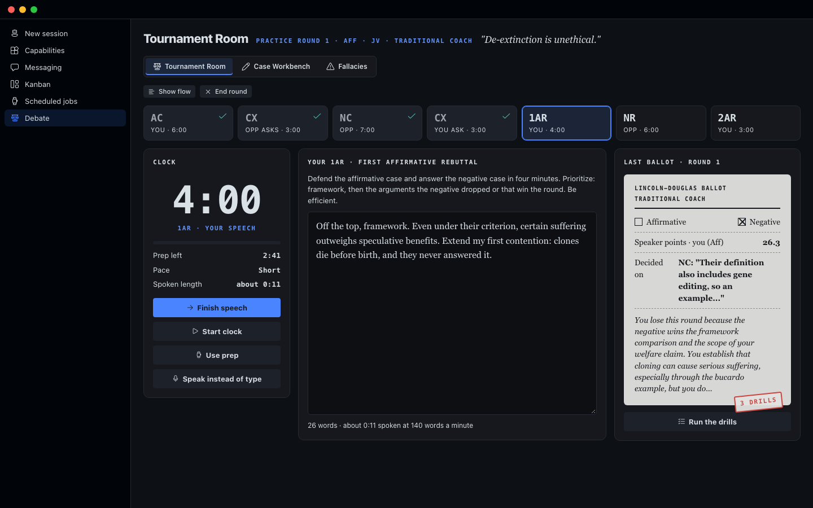

# LD Workbench for Hermes

Practice Lincoln-Douglas debate inside the Hermes desktop app.

You write your own case. A coach reads it, finds the weak spot, and asks the question that makes it stronger. Then you debate a full practice round against an AI opponent, with real NSDA speech times, and a judge writes you a ballot with the lines that decided the round and three drills to practice.

It uses the AI model you already set up in Hermes. It never writes your case for you.

## What you can do

**Tournament Room.** A full practice round in NSDA order: your constructive, cross-examination, the opponent's case, rebuttals, and the last speeches. Speech times are 6, 3, 7, 3, 4, 6 and 3 minutes, with 4 minutes of prep. A clock runs each speech and your prep. The opponent comes in three levels: Novice, JV and Varsity. You question the opponent, and the opponent questions you. A flow sheet fills in as you go. At the end, a judge you pick (a parent judge, a traditional coach, or a flow judge) writes the ballot. You can ask another judge to rule on the same round, or redo one of your speeches and have the same judge rule again.

**Case Workbench.** Your case in sections: resolution analysis, definitions, value, criterion, contentions, and blocks. A six-step writing path walks you from a blank page to a finished case. Every section has helpers that lay out your options and ask hard questions, and a coach panel you can talk to.

**Fallacies.** A guide to 15 common mistakes in reasoning, each with a plain definition, an example, and what to do about it in a round. A practice drill gives you a short argument; you pick the fallacy it commits (or "No fallacy"), see whether you were right and why, and keep a score for the session. You can also paste any argument and have it checked. In the Tournament Room, a "Spot fallacies" button sits under every speech the opponent gives.

**My cases.** Keep as many cases as you want. Each one has its own name, resolution, side, sections and coach notes. Make a new one, copy one, or delete one. Save any case as a Word document or a text file, or print it. Save a backup file of every case, and load it on another computer.

**Bring in your case.** Paste a case you already wrote, or upload it as a Word document or text file. The workbench sorts your words into the sections without changing a single word, then the coach reviews it.

## How to install it

You need the Hermes desktop app, version 0.22 or newer, with a model already set up.

1. Download this folder to your computer.
2. Open the Terminal app and type this line, with the real place you saved the folder:
   `ln -s /path/to/hermes-ld-workbench ~/.hermes/plugins/ld-workbench`
3. Turn on the plugin's helper program by typing:
   `hermes plugins enable ld-workbench`
4. Open Hermes. Go to Capabilities, then Plugins. Find LD Workbench and switch it on.
5. Click **Debate** in the left sidebar.

To check that everything is in place, type `hermes plugins doctor ld-workbench`. It should say OK.

## Where your work is saved

Your cases, coach notes, rounds and ballots are saved by Hermes on your own computer, in a folder named `plugin-data/ld-workbench` inside your Hermes folder. Nothing is sent anywhere except to the AI model you chose in Hermes, which reads your case when you ask for help.

## The coaching rule

The coach helps and pushes. It explains ideas, lays out choices, and points to where evidence lives. It does not write your case, and it never makes up quotes, numbers or sources. If you ask it to write your case, it says the words have to be yours and gives you the next step instead.

## For developers

- The method (every prompt, the round format, the judges) is in `ld_method.py`, copied from the LD Workbench web app. Keep the two in sync.
- The backend is `dashboard/plugin_api.py`. All model calls go through Hermes's plugin model access (`PluginLlm`), so they use the user's own model and keys.
- The page is built from `desktop/src/plugin.js` with the shared Hermes UI kit: `node <path-to>/hermes-ui-kit/scripts/build.mjs .`
- Tests: `/usr/bin/python3 -m unittest discover -s tests`
- Screenshots: serve the folder (`/usr/bin/python3 -m http.server 8793 --directory .`) and run `harness/shoot.sh`.

License: MIT. By Damon Gardenhire.
