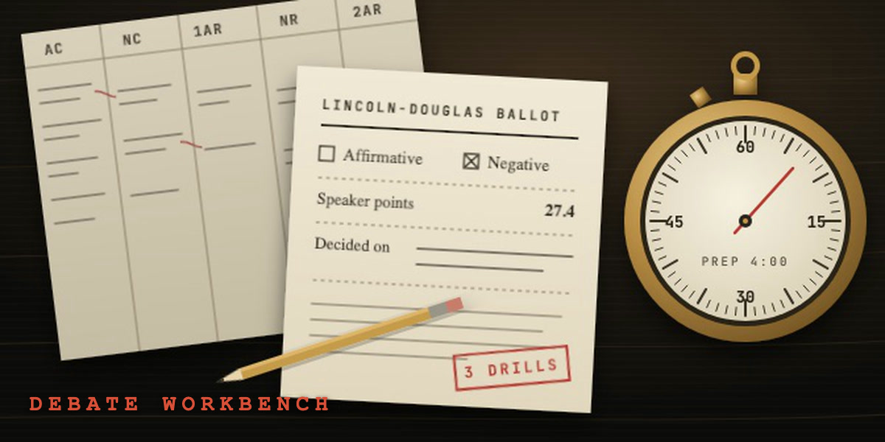
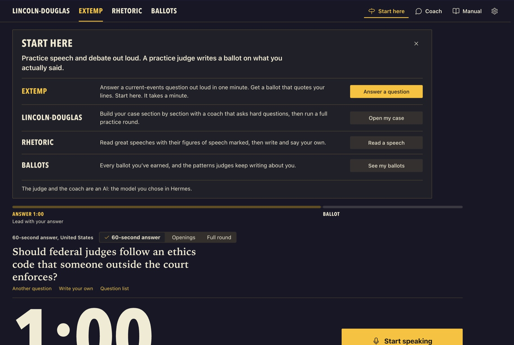

# Debate Workbench for Hermes

**New in 0.2:** three new rooms. Extemp, with answers spoken on a real clock; Rhetoric, which marks the figures in famous speeches; and Ballots, which counts your habits across rounds and shows which way each is heading.

Practice speech and debate out loud, inside the Hermes desktop app: extemp, Lincoln-Douglas and rhetoric.

You speak on a real clock. A practice judge writes a ballot that quotes three of your own lines, and code checks each quoted line against what you said. In Lincoln-Douglas, where the judge may shorten a line with "...", a quoted line with no run of three or more words is left unchecked. Every ballot is kept, so the things judges write more than once show up as patterns you can drill.

The opponent, the judge and the coach are the AI model you already set up in Hermes. The coach asks questions and critiques first. After you try, it can show a strong answer, a strong opening or a draft for your case. Each one sits in a box labeled as the coach's, and a teacher can turn the examples off.

## What you need

- Hermes Desktop, version 0.21.6 or newer. Version 0.2.0 was run live on Hermes 0.23.1 (Nov 11, 2026); older versions are untested.
- A model already set up in Hermes. Debate Workbench uses it for the opponent, the judge and the coach. If you've chatted with Hermes, you already have one; if not, open Hermes Settings, Model.
- A microphone, if you want to speak. Without one you can type everything.
- For transcripts of what you say: the speech-to-text set up in Hermes (Hermes Settings, Voice). If that is not available, the workbench can use its own speech model after you approve a download of about 145 MB. With neither, a spoken take still gets real timing and pauses, and you can type what you said. Debate Workbench installs no speech software.
- Optional: web search turned on in Hermes Settings, Tools (for Get up to speed and for extemp prep with the internet allowed), and a voice set up in Hermes Settings, Voice (for Hear it).

## How to install it

Debate Workbench is in the Hermes plugin catalog.

1. In Hermes Desktop, open the plugin catalog, find **Debate Workbench** and click **Install**. Keep both parts selected: the agent plugin and the desktop plugin.
2. In **Capabilities**, then **Plugins**, switch **Debate Workbench** on.
3. Click **Debate** in the left sidebar.

To install from Git instead: in Hermes Desktop, click **Capabilities**, then **Plugins**, then **Install from Git**, and paste `https://github.com/Dgardenhire/hermes-ld-workbench`. Or in a terminal run `hermes plugins install Dgardenhire/hermes-ld-workbench --enable`. Then do steps 2 and 3.

To check the install, run `hermes plugins doctor ld-workbench`. It should say OK.

Upgrading from 0.1: install 0.2 the way you installed 0.1. Your 0.1 data folder opens unchanged. The plugin does not update itself.

The manual, with screenshots and a troubleshooting list, is at [linchpin.studio/hermes/ld-workbench/manual](https://linchpin.studio/hermes/ld-workbench/manual/). What changed in 0.2: [CHANGELOG.md](CHANGELOG.md).

## Uninstall

Open Capabilities, then Plugins, and turn Debate Workbench off, or click **Uninstall** beside it. In a terminal: `hermes plugins remove ld-workbench`.

Removing the plugin leaves your work where it is, in `plugin-data/ld-workbench` inside your Hermes folder (cases, rounds, ballots, recordings, transcripts, your extemp file and the speech model, if it was downloaded), so reinstalling picks up where you left off. To erase everything, delete that folder after removing the plugin. Files you exported to your own folders are not touched.

## What you can do

One row runs across the top of the page: Lincoln-Douglas, Extemp, Rhetoric and Ballots on the left, **Start here**, **Coach**, **Manual** (opens the manual in your browser) and a gear for Settings on the right. When Lincoln-Douglas is open, Case, Round and Fallacies sit beside it, in that order: build the case, then run a round with it. In any Hermes chat, `/debate` gives today's question and your top counted pattern.

**Speak, on the clock.** Every event shares one floor. A strip across the top draws the event to scale in time: each part is as wide as its minutes. The big clock starts at your first sound, not when you press the button. The time cards flip at each minute, at 30 seconds and at Time. While you speak, your voice is drawn as it comes in, with a mark over every pause longer than 2 seconds. A take stops by itself one minute after time runs out, or after two minutes with no sound. No microphone? Type your speech; the time is estimated at 140 words a minute, and it says so.

Each spoken take shows time, words a minute, fillers and pauses. Time and pauses are worked out on your computer from the recording. Words a minute and fillers come from the transcript. Under the take is a player: press play, and read what you said underneath, with fillers underlined and each long pause marked.

**Word times, and what depends on them.** Only the workbench's own speech model gives the time of each word. Hermes's speech-to-text returns text without word times. When your transcript comes from Hermes, three things change. The "to your answer" time is left out of the take. The move "Answer before 0:10" cannot be met and reads "no answer heard". And on a ballot, the play mark on each quoted line starts where the pauses in your recording put that sentence, so a line can start a moment early or late instead of at the exact word. With the workbench's own model, the quoted line plays exactly, the word being said lights up, and you can click any word to jump to it.

**Extemp.** It opens on a 60-second answer, ready to speak: one question, one minute, a ballot in under a minute. The question changes each visit, from 52 built in (United States and International), or write your own. A coach can add this week's questions, and **Ask only my questions** makes the floor use only those.

- **Get up to speed.** One press searches with your Hermes web search, reads up to 4 public pages, and shows three facts. Each fact is a sentence copied from a page, never retyped, with the page's own outlet and date (or "no date"), plus **Open the page** and **Save to my file**. The coach's read says what the question really asks and the best answer each way. If web search is off in Hermes, it says so and shows what your file has.
- **The ballot.** Time, saved sources you named (the sources from your extemp file you named aloud; the judge also credits a source you name that is not in your file) and pace; Answered the question? as Yes, Partly or No; points from 20 to 30 with a key to what the numbers mean; three of your lines the judge quoted, each checked against your words; and one drill.
- **Show me a strong answer.** The coach's own answer to the same question, built on yours, with your take beside it. A label under each coach sentence says which of your lines it builds on, or that it is new. It cites only headlines saved in your own file. Below it, Why it works has a Yours half and a This version half, so you are not credited with the coach's move.
- **Try it again.** Lists up to three moves to practice, from a fixed list: answer before 0:10, an outlet and its month in the first 30 seconds, 2 fillers or fewer, and 130 to 170 words a minute. After your second take, each move is marked Met or Not met, and a table sets Take 1 against Take 2. Every number comes from code, not from the model.
- **Openings.** Three 45-second tries at opening the same question three different ways. The coach marks the strongest and says why; **Show me a strong opening** gives one of its own, built on yours.
- **Full round.** Pull this week's headlines on your topic from twelve outlets: five that AllSides labels left or lean left, two center and five right or lean right. They appear side by side and labeled by lean. You can add, remove and relabel outlets, up to 16. Save headlines to your extemp file. Draw three questions from your own saved news, pick one, and prep for 30 minutes with an outline and sources from your file, files only or with the internet allowed through your Hermes web search. **Suggest areas** gives three areas that back your answer, each with a source from your file. **Find me evidence** picks saved headlines that bear on a point and says whether each supports it, cuts against it, or is background. Then give a 7-minute speech and get an extemp ballot that adds how many sources you named and when they were from.

**Lincoln-Douglas.** Write your own case in the Case page, in sections: resolution analysis, definitions, value, criterion, up to three contentions, blocks and other material. The helpers (Break down the resolution, Find definitions, Value options, Criterion options, Map the arguments, Attack my case, Check my logic, Stress-test the framework, Socratic coach and others) explain, question and point to where evidence lives. Once you have written some of the case, the coach can also write short drafts: Suggest contentions, Suggest a value and criterion, Write a block to an attack you paste, and Strengthen this card. Each draft is labeled Coach's suggestion, and evidence the coach cannot know is left as "[find a card: ...]". A draft goes into your case only when you press Add, and then it goes in marked for you to rewrite.

Then debate a full practice round in NSDA order against an AI opponent (Novice, JV or Varsity): AC 6, CX 3, NC 7, CX 3, 1AR 4, NR 6 and 2AR 3 minutes, with 4 minutes of prep. Speak your speeches or type them. In cross-examination you and the opponent question each other. A flow sheet fills in as you go, and in your speeches after the opponent has spoken it sits beside the clock. A judge you pick (parent judge, traditional coach, flow judge or circuit judge) writes the ballot. **Ask another judge** gets a second ruling on the same round; **Redo a speech** gives one speech again and has the same judge read it.

A topic briefing maps each new resolution for both sides. Fallacies has a practice drill, a checker for any argument you paste, a guide to 15 common fallacies, and **Spot fallacies** under each opponent speech; every "Exact words" quote the checker gives is compared with what you pasted. Keep as many cases as you want. Import a case from a Word document or text file without a word changed, export to Word or text, print, or save and load a backup file.

**Rhetoric.** Six public-domain speeches with their figures of speech underlined. Press any mark, or Tab to it and press Enter, and a panel gives the figure's name, a one-line definition, the line itself and why it works in that line. Those notes were written once ahead of time and every quote in them is tested against the speech; no model marks the six speeches. Below each is **Try it**: write your own line using that figure, and the coach answers with questions, not wording. Then Figures (grouped by the effect they make), Spot (name the figure in a real line), Write (the coach critiques your line; after the critique, **Show me three versions** shows your line three ways) and Say it (30 seconds, out loud). Paste any speech, essay or case and the model finds the figures; every mark is checked against your text as an exact quote, and a mark that is not there is dropped. The definitions are shared with The Clearing, another plugin by the same author. Further reading: Mark Forsyth, *The Elements of Eloquence*.

**Ballots.** Every ballot from every event, newest first. The patterns judges keep writing are counted in code from a fixed list ("You drop arguments in the 2AR: 4 of your last 6"), not guessed by the model. Pace, time, pauses and a late answer are measured from your recordings. Tick a drill when you have done it, and press **Show me** under it to have the coach quote your weakest moment and model a redo. Print every ballot, or save them as one text file to send your coach.

**Ask the coach.** **Coach** at the top right opens a chat beside any page about what is on screen: the question, your words, your extemp file, the ballot, your line or your case.

**Settings.** Turn coach examples on or off (one setting for the whole Hermes profile), see which speech-to-text makes your transcripts and, when the workbench uses its own, pick the model, delete your recordings, delete your transcripts and ballots, edit your news outlets and their lean labels, and read exactly what leaves your computer.

**Start here.** The first time you open Debate, a Start here panel names the four rooms in one line each, with a button into each, and says that the judge and the coach are an AI: the model you chose in Hermes. Close it and it stays closed; **Start here** in the top row opens it again.

**First open.** Until you have a take or a ballot of your own, a Sample ballot sits under the clock, read aloud by a sample voice (see the credit under Disclosures).

## Where your work is saved

Your cases, coach notes, rounds, ballots, topic briefings, recordings, transcripts and extemp file are saved by Hermes on your own computer, in a folder named `plugin-data/ld-workbench` inside your Hermes folder. There are no accounts and no tracking.

So the page opens at once, the Hermes app also keeps a copy of what the page last showed when it opened (your open case and round, your last take on each floor, the question list and your settings) in its own storage for this plugin, on the computer you run the app on. The copy is under 200 KB, never holds a key or password, is shown only for the same Hermes profile and plugin version, is replaced by your saved work a moment after the page opens, and is cleared by either delete in Settings. The same storage remembers that you closed Start here.

## What leaves your computer

- **Your AI model.** When you use the coach, a helper, the briefing, a round, a ballot, the question draw, Get up to speed or the figure finder, the text it needs (your case, your speeches and transcripts, the resolution, your typed questions, your saved headlines) goes to the AI model you chose in Hermes, through Hermes. Debate Workbench has no keys of its own. Recordings are never sent to a model.
- **Your voice is kept on your computer.** The microphone is open only between Start speaking and Stop (or Cancel, an error, or leaving the page). Recordings are saved only in `plugin-data/ld-workbench/recordings/` inside your Hermes folder: the newest 20, never more than 100 MB, with a button to delete them all. If your Hermes app talks to Hermes on another computer, the recording goes to that computer.
- **Transcripts follow your Hermes voice settings.** Each recording is transcribed by Hermes's own speech-to-text, the one Hermes's voice input uses (Hermes Settings, Voice). **If that is a cloud service (OpenAI, Groq, Mistral, xAI, ElevenLabs or DeepInfra), or Hermes picks one at run time, a take is never sent on its own: the take names where it would go and waits until the student presses Transcribe now on it, every take. Then that recording goes to that service to be transcribed, under its privacy terms.** When the workbench's own speech model is already on the computer, it makes the transcript there instead, with no press. If it is local, the recording stays on the computer. Settings and every take say which one made the transcript. When Hermes cannot make it without first downloading a model of its own, or its speech-to-text is off or fails, the workbench uses its own faster-whisper on the computer instead, with its speech model in `plugin-data/ld-workbench/models/`, never in the shared Hugging Face cache. That model is downloaded from huggingface.co (about 145 MB for base.en, once, no audio is sent) only when you press Transcribe now after the take tells you its size; a new recording never starts a download on its own. The download runs as one short separate Python process with fixed arguments and its own Hugging Face settings, so your Hugging Face cache, settings and token are never used.
- **Headlines, only when you press Pull headlines.** For your topic, a Google News search for each outlet on your list (`news.google.com`), and that outlet's own news feed if Google does not answer. Headlines, dates and links only; no article is downloaded. Https only, public addresses only, 8 seconds and 250 KB per outlet, 20 seconds for the whole pull. Links open in your own browser.
- **Get up to speed, only when you press it.** Your question goes to the web search you set up in Hermes. Then Debate Workbench itself opens up to 4 of the public pages that come back, to read their text: public addresses only, 12 seconds per page. Numbered sentences picked from those pages go to your AI model, which returns sentence numbers and a short read of the question. A page's text is never shown as HTML and never saved unless you press Save to my file. Debate Workbench has no search key of its own.
- **A web search, only in an extemp round you start with the internet allowed.** The words you search for go to the web search you set up in Hermes. Titles, links and short snippets come back.
- **The coach's example, prepared after each 60-second answer.** This is the one request that starts without a button press. After a 60-second answer is judged, and only with Coach examples on, the coach's example is written in the background by the same AI model, from your words and your extemp file, so it is ready when you press Show me a strong answer. If you never open it, it is dropped. Turning Coach examples off stops it.
- **Hear it, only when you press it.** The opponent's speech or the coach's example (written by the AI, not by you) goes to the voice you set up in Hermes to be read aloud. The audio is kept in `plugin-data/ld-workbench/voice/`, newest 8 only.
- **A link you save or add as a topic source.** Debate Workbench opens that one public web page to read its text: public addresses only, every redirect checked, 20-second limit, first 30,000 characters kept.

Nothing else is sent. Each request carries your computer's internet address, as any web request does. Lean labels are from the AllSides Media Bias Ratings, checked Nov 7, 2026, and you can change any of them.

## Students and minors

Debate Workbench is built for students, many of them under 18. It has no accounts, asks for no name, age, school or email, and keeps no tracking. A student's voice stays on the computer that runs Hermes, unless the speech-to-text set up in Hermes is a cloud service and the student presses Transcribe now on a take: then that recording goes to that service to be transcribed (the take and Settings name it). Nothing is sent before that press. An adult who wants the voice to stay put chooses local speech-to-text in Hermes Settings, Voice. The other things that leave are the ones listed above: the student's words (their case, their speeches and transcripts, their typed questions) go to the AI model chosen in Hermes; a headline topic goes to Google News; a question or a search typed into Get up to speed or an internet-allowed prep goes to the web search set up in Hermes, and up to 4 of the pages it returns are opened; a link the student saves is opened once. Whoever sets up Hermes for a student chooses that model, that search and that voice, and their privacy terms apply.

Settings has two deletes, each with a confirm. Delete all recordings removes every audio file at once. Delete transcripts and ballots removes every transcript, the words kept with each take, every ballot, and any round in progress; recordings, timing, cases and the extemp file stay. Deleting `plugin-data/ld-workbench` (or uninstalling the plugin and removing its data) erases everything Debate Workbench kept.

## Disclosures

- **Microphone.** Hermes may ask once for microphone permission. The microphone is open only while you are speaking a take, never in the background.
- **Recordings of students.** Recordings stay on the computer that runs Hermes; with a cloud speech-to-text set in Hermes, a recording is sent to that service only when the student presses Transcribe now on that take. If a minor uses it, a parent or coach can delete every recording, and every transcript and ballot, in Settings at any time.
- **The opponent, the judge and the coach are an AI model,** the one you chose in Hermes. Their ballots are practice ballots, not the ruling of a real judge. Patterns across ballots are counted in code from a fixed list; quoted lines are checked against what was said and flagged when they are not there (a Lincoln-Douglas line with no run of three or more words is left unchecked).
- **Transcripts are optional.** Debate Workbench installs nothing. It uses Hermes's own speech-to-text, and faster-whisper only when Hermes's local speech-to-text has already installed it. Without either, takes keep real timing and pauses. See "Word times, and what depends on them" above.
- **One private Hermes import.** To use Hermes's own speech-to-text, the backend imports `tools.voice_mode.transcribe_recording` (in `speech.py`), the function behind Hermes's core `/api/audio/transcribe` route. It is not in Hermes's public plugin API (`hermes_cli/data/plugin_api.json`), so `hermes plugins validate` lists it as a warning. The reason: a desktop page cannot call the core route (plugin pages reach only `/api/plugins/<id>/`), and there is no public transcription call for plugins yet. The import is guarded; if a Hermes release moves the function, transcripts fall back to the workbench's own faster-whisper instead of breaking, and timing-only mode always works. It reads the profile's `stt` settings through the public `hermes_cli.config`. **An issue to raise with Nous:** plugins can register a transcription provider (`ctx.register_transcription_provider`, `agent.transcription_provider` in the public API) but have no public way to ask the active provider for a transcript. A `ctx.transcribe(path)` (or a `transcribe_audio` tool reachable through `ctx.dispatch_tool`) would let this import go.
- **What it registers.** A Desktop page, a dashboard API, the `/debate` command, two read-only agent tools (`debate_record` and `debate_today`, which give counts, tags, dates and question text, never what you said or what a judge wrote, and refuse to run in scheduled jobs), three model rows (Debate judge, Debate opponent, Debate coach, 180-second limit each) and a bundled `debate-coach` skill. No hooks or middleware.
- **News.** Headlines and links only, from Google News RSS and the outlets' own feeds. Lean labels are from the AllSides Media Bias Ratings, checked Nov 7, 2026, and every label can be changed. Inclusion of an outlet is not an endorsement.
- **Speeches and definitions.** The six speeches in Rhetoric are public domain (texts from Wikisource). The figure definitions are shared with The Clearing, another plugin by the same author. Further reading: Mark Forsyth, *The Elements of Eloquence* (Icon Books, 2013).
- **Sample voice.** The Sample on the first open is read by **Arthur**, a voice from the ElevenLabs Voice Library (voice ID `i32gAGa2D3T8nPzY1EsZ`), generated for this plugin by Damon Gardenhire on Nov 9, 2026 (`data/sample_voice.webm`, about 250 KB). The words are the plugin's own written sample answer. It was made on a paid ElevenLabs subscription. Arthur's Voice Library record (checked Nov 9, 2026) lists category professional, free_users_allowed true and a 730-day notice period, with no extra terms from the voice's creator. The recording is ElevenLabs output, used under the ElevenLabs Terms of Service and its Voice Library terms; it is **not** covered by this repository's MIT license. Voice generated with ElevenLabs (elevenlabs.io).
- **Not affiliated.** Debate Workbench is an independent community plugin. It is not made or endorsed by Nous Research, the National Speech & Debate Association, AllSides or any news outlet.
- **No background jobs, telemetry or self-updates.** The only request that starts without a button press is the coach's example after a 60-second answer, described above. No shell commands. Two helper programs may run, each with fixed arguments: ffmpeg (only when PyAV is missing) to turn a take into the WAV Hermes's speech-to-text expects, and one Python process for the speech-model download you ask for.

## The coaching rule

You try first. The coach critiques what you tried, asks the question that makes it stronger, and points to where evidence lives. After you have tried, it can also write: a strong answer or opening on your question, three versions of your line, a modeled redo of the weakest moment on a ballot, and short drafts of contentions, a value and criterion, a block or a stronger card tag. Everything the coach writes is labeled as the coach's, and none of it goes into your case until you press Add, and then it goes in marked for you to rewrite. These are examples to learn the moves from; say it your own way.

Under each coach box, a line says what code checked. Before you see anything the coach wrote, code checks every citation, every quoted run of four or more words, every figure and every date against your file and your own words, and marks anything it cannot find ("Not a source in your file. Do not cite it." or "Not in your sources or your words. Check it before you use it."). An extemp example cites only the headlines in your own file. The check compares the coach's words with your own file. It does not tell you a source is true, so read a source before you cite it. On contested questions the coach takes an answer when the event demands one, gives the other side its strongest point, and takes no side on parties or people.

A teacher can turn **Coach examples** off in Settings for a room where students write every word. Then the coach only asks, explains and critiques, and the chat writes nothing for a student to say.

## For developers

- The method (every prompt, the round format, the judges) is in `ld_method.py`, copied from the web app at linchpin.studio/debate. Keep the two in sync.
- The coach's examples and suggestions, their prompts and the citation check are in `coach.py` (plugin only; `ld_method.py` stays the web app's mirror).
- The backend is `dashboard/plugin_api.py`. All model calls go through Hermes's plugin model access (`PluginLlm`), so they use the user's own model and keys.
- The page is built from `desktop/src/plugin.js` with the shared Hermes UI kit: `node <path-to>/hermes-ui-kit/scripts/build.mjs .`
- Tests: `/usr/bin/python3 -m unittest discover -s tests`
- Screenshots: serve the folder (`/usr/bin/python3 -m http.server 8793 --directory .`) and run `harness/shoot.sh`. `harness/live.mjs` records from Chrome's fake microphone to check the recorder. `harness/make_fixtures.py` rebuilds the 0.2 fixtures from the plugin's own code; `harness/make_coach_fixtures.py` puts the hand-written coach answers through the plugin's own checks.
- Status, risks and what is left: `docs/STATUS.md`.

License: MIT. By Damon Gardenhire.
