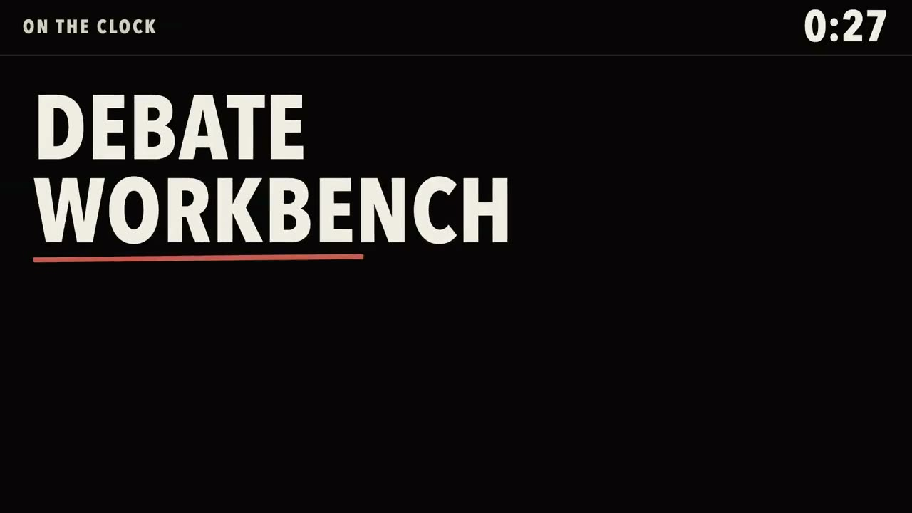
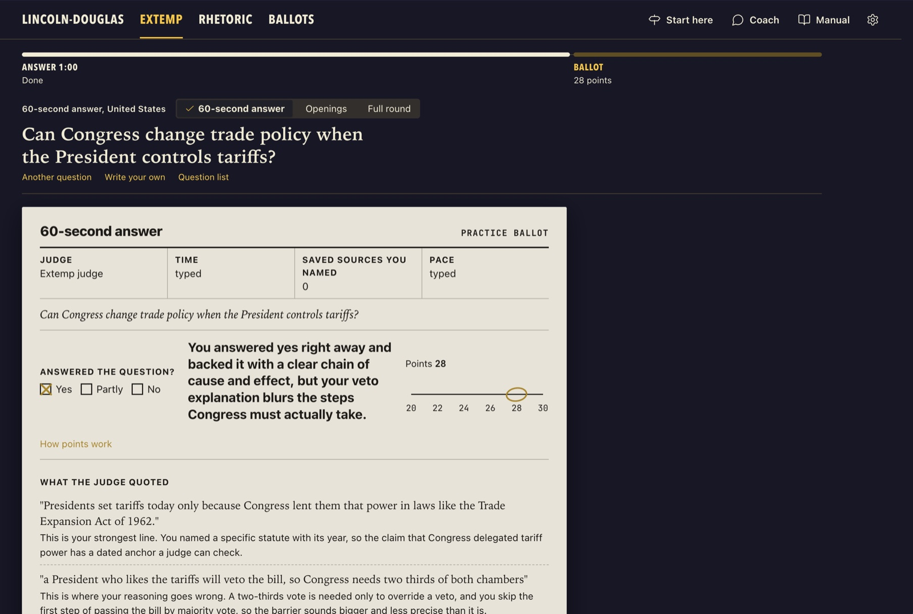
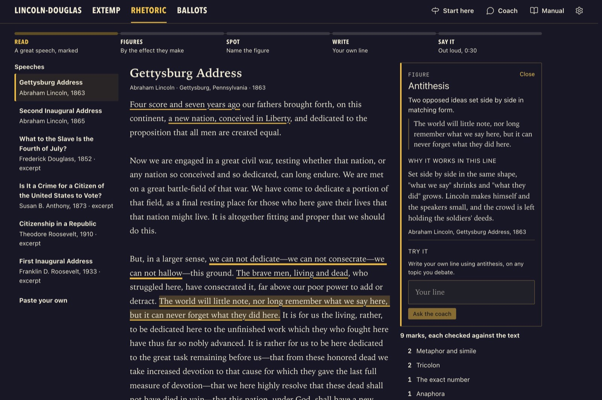
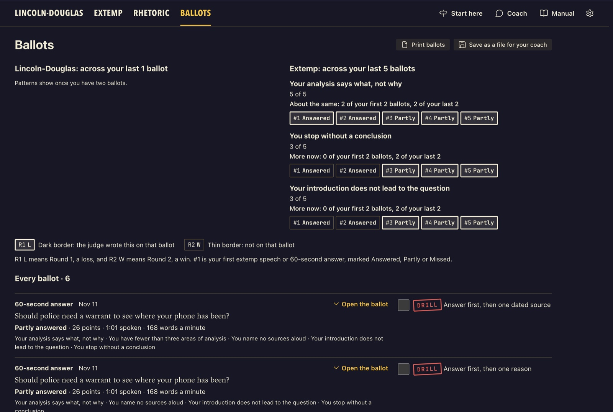

# Debate Workbench for Hermes

**[Watch the 30-second demo](https://linchpin.studio/hermes/video/debate.mp4)** · [Manual](https://linchpin.studio/hermes/ld-workbench/manual/) · [All four plugins](https://linchpin.studio/hermes/)

**New in 0.2:** three new rooms. Extemp, with answers spoken on a real clock; Rhetoric, which marks the figures in famous speeches; and Ballots, which counts your habits across rounds and shows which way each is heading.

Debate Workbench is a practice space for high school debate students inside Hermes Agent, with four rooms: Lincoln-Douglas, Extemp, Rhetoric and Ballots. Run a full timed round against an AI opponent, answer a question out loud on a real clock, and get a ballot after every round that quotes your own lines back to you.

A practice judge writes a ballot that quotes three of your own lines, and each quoted line is checked against what you said. In Lincoln-Douglas the judge may shorten a line with "...", and a quoted line with no run of three or more words is left unchecked. Every ballot is kept, so the things judges write more than once show up as patterns you can drill.

The opponent, the judge and the coach are the AI model you already set up in Hermes. The coach asks questions and critiques first. After you try, it can show a strong answer, a strong opening or a draft for your case. Each one sits in a box labeled as the coach's, and a teacher can turn these Coach examples off.

## What you need

- Hermes Desktop, version 0.21.6 or newer.
- A model already set up in Hermes. If you've chatted with Hermes, you already have one; if not, open Hermes Settings, Model.
- A microphone, if you want to speak. Without one you can type everything.
- For transcripts of what you say: the speech-to-text set up in Hermes (Hermes Settings, Voice). If that is not available, the workbench can use its own speech model after you approve a download of about 145 MB. With neither, a spoken take still gets real timing and pauses, and you can type what you said.
- Optional: web search turned on in Hermes Settings, Tools (for Get up to speed and for extemp prep with the internet allowed), and a voice set up in Hermes Settings, Voice (for Hear it).

## How to install it

Debate Workbench is in the Hermes plugin catalog.

1. In Hermes Desktop, open the plugin catalog, find **Debate Workbench** and click **Install**. Keep both parts selected: the agent plugin and the desktop plugin.
2. In **Capabilities**, then **Plugins**, switch **Debate Workbench** on.
3. Click **Debate** in the left sidebar.

To install from Git instead: in Hermes Desktop, click **Capabilities**, then **Plugins**, then **Install from Git**, and paste `https://github.com/Dgardenhire/hermes-ld-workbench`. Or in a terminal run `hermes plugins install Dgardenhire/hermes-ld-workbench --enable`. Then do steps 2 and 3.

To check the install, run `hermes plugins doctor ld-workbench`. It should say OK.

Upgrading from 0.1: install 0.2 the way you installed 0.1. Your saved work opens unchanged.

The manual, with screenshots and a troubleshooting list, is at [linchpin.studio/hermes/ld-workbench/manual](https://linchpin.studio/hermes/ld-workbench/manual/). What changed in 0.2: [CHANGELOG.md](CHANGELOG.md).

## Uninstall

Open Capabilities, then Plugins, and turn Debate Workbench off, or click **Uninstall** beside it. In a terminal: `hermes plugins remove ld-workbench`.

Removing the plugin keeps your work in `plugin-data/ld-workbench` inside your Hermes folder, so reinstalling picks up where you left off. To erase everything, delete that folder after removing the plugin. Files you exported to your own folders stay where you saved them.

## What you can do

One row runs across the top of the page: Lincoln-Douglas, Extemp, Rhetoric and Ballots on the left, **Start here**, **Coach**, **Manual** and a gear for Settings on the right. When Lincoln-Douglas is open, Case, Round and Fallacies sit beside it: build the case, then run a round with it. In any Hermes chat, `/debate` gives today's question and your top pattern.

**Speak, on the clock.** A strip across the top draws the event to scale: each part is as wide as its minutes. The big clock starts at your first sound, not when you press the button. The time cards flip at each minute, at 30 seconds and at Time. While you speak, your voice is drawn as it comes in, with a mark over every pause longer than 2 seconds. A take stops by itself one minute after time runs out, or after two minutes with no sound. No microphone? Type your speech; the time is estimated at 140 words a minute, and it says so.

Each spoken take shows time, words a minute, fillers and pauses. Under the take is a player: press play and read what you said underneath, with fillers underlined and each long pause marked. With the workbench's own speech model, the word being said lights up and you can click any word to jump to it. Hermes's speech-to-text gives text without word times, so with it the "to your answer" time and the "Answer before 0:10" move are not available, and a quoted line on a ballot starts playing near its first word rather than exactly on it.

**Extemp.** It opens on a 60-second answer, ready to speak: one question, one minute, then a ballot. The question changes each visit, from 52 built in (United States and International), or write your own. A coach can add this week's questions, and **Ask only my questions** makes the floor use only those.

- **Get up to speed.** One press searches with your Hermes web search, reads up to 4 public pages, and shows three facts. Each fact is a sentence copied from a page, with the page's own outlet and date (or "no date"), plus **Open the page** and **Save to my file**. The coach's read says what the question really asks and the best answer each way.
- **The ballot.** Time, the sources you named aloud, and pace; Answered the question? as Yes, Partly or No; points from 20 to 30 with a key to what the numbers mean; three of your lines the judge quoted, each checked against your words; and one drill.
- **Show me a strong answer.** The coach's own answer to the same question, built on yours, with your take beside it. A label under each coach sentence says which of your lines it builds on, or that it is new. It cites only headlines saved in your own file. Below it, Why it works has a Yours half and a This version half, so you are not credited with the coach's move.
- **Try it again.** Up to three moves to practice: answer before 0:10, an outlet and its month in the first 30 seconds, 2 fillers or fewer, and 130 to 170 words a minute. After your second take, each move is marked Met or Not met, and a table sets Take 1 against Take 2.
- **Openings.** Three 45-second tries at opening the same question three different ways. The coach marks the strongest and says why; **Show me a strong opening** gives one of its own, built on yours.
- **Full round.** Pull this week's headlines on your topic from twelve outlets: five that AllSides labels left or lean left, two center and five right or lean right, side by side and labeled by lean. Add, remove and relabel outlets, up to 16. Save headlines to your extemp file. Draw three questions from your saved news, pick one, and prep for 30 minutes with an outline and sources from your file, with or without the internet. **Suggest areas** gives three areas that back your answer, each with a source from your file. **Find me evidence** picks saved headlines that bear on a point and says whether each supports it, cuts against it, or is background. Then give a 7-minute speech and get an extemp ballot that also counts the sources you named and how recent they were.

**Lincoln-Douglas.** Write your own case in the Case page, in sections: resolution analysis, definitions, value, criterion, up to three contentions, blocks and other material. The helpers (Break down the resolution, Find definitions, Value options, Criterion options, Map the arguments, Attack my case, Check my logic, Stress-test the framework, Socratic coach and others) explain, question and point to where evidence lives. Once you have written some of the case, the coach can also write short drafts: Suggest contentions, Suggest a value and criterion, Write a block to an attack you paste, and Strengthen this card. Each draft is labeled Coach's suggestion, and evidence the coach cannot know is left as "[find a card: ...]". A draft goes into your case only when you press Add, and then it goes in marked for you to rewrite.

Then debate a full practice round in NSDA order against an AI opponent (Novice, JV or Varsity): AC 6, CX 3, NC 7, CX 3, 1AR 4, NR 6 and 2AR 3 minutes, with 4 minutes of prep. Speak your speeches or type them. In cross-examination you and the opponent question each other. A flow sheet fills in as you go. A judge you pick (parent judge, traditional coach, flow judge or circuit judge) writes the ballot. **Ask another judge** gets a second ruling on the same round; **Redo a speech** gives one speech again and has the same judge read it.

A topic briefing maps each new resolution for both sides. Fallacies has a practice drill, a checker for any argument you paste, a guide to 15 common fallacies, and **Spot fallacies** under each opponent speech. Keep as many cases as you want. Import a case from a Word document or text file without a word changed, export to Word or text, print, or save and load a backup file.

**Rhetoric.** Six public-domain speeches with their figures of speech underlined. Press any mark, or Tab to it and press Enter, and a panel gives the figure's name, a one-line definition, the line itself and why it works there. Below each is **Try it**: write your own line using that figure, and the coach answers with questions, not wording. Then Figures (grouped by the effect they make), Spot (name the figure in a real line), Write (the coach critiques your line; after the critique, **Show me three versions** shows your line three ways) and Say it (30 seconds, out loud). Paste any speech, essay or case and the model finds the figures, each one checked against your text.

**Ballots.** Every ballot from every event, newest first. The patterns judges keep writing are counted from a fixed list ("You drop arguments in the 2AR: 4 of your last 6"). Pace, time, pauses and a late answer are measured from your recordings. Tick a drill when you have done it, and press **Show me** under it to have the coach quote your weakest moment and model a redo. Print every ballot, or save them as one text file to send your coach.

**Ask the coach.** **Coach** at the top right opens a chat beside any page about what is on screen: the question, your words, your extemp file, the ballot, your line or your case.

**Settings.** Turn Coach examples on or off, see which speech-to-text makes your transcripts and pick the workbench's own speech model, delete your recordings, delete your transcripts and ballots, edit your news outlets and their lean labels, and read exactly what leaves your computer.

**Start here.** The first time you open Debate, a Start here panel names the four rooms with a button into each, and says that the judge and the coach are an AI: the model you chose in Hermes. Until you have a take or a ballot of your own, a sample ballot sits under the clock, read aloud by a sample voice.

## Where your work is saved

Your cases, coach notes, rounds, ballots, topic briefings, recordings, transcripts and extemp file are saved on your own computer, in `plugin-data/ld-workbench` inside your Hermes folder. There are no accounts and no tracking. So the page opens at once, the Hermes app also keeps a small copy of what the page last showed, for this plugin only; either delete in Settings clears it.

## What leaves your computer

- **Your AI model.** When you use the coach, a helper, the briefing, a round, a ballot, the question draw, Get up to speed or the figure finder, the text it needs (your case, your speeches and transcripts, the resolution, your typed questions, your saved headlines) goes to the AI model you chose in Hermes. Recordings are never sent to a model.
- **Your voice.** The microphone is open only between Start speaking and Stop. Recordings are saved only in `plugin-data/ld-workbench/recordings/`: the newest 20, never more than 100 MB, with a button to delete them all.
- **Transcripts.** Each recording is transcribed by the speech-to-text set up in Hermes. If that is a local one, the recording stays on the computer. If it is a cloud service (OpenAI, Groq, Mistral, xAI, ElevenLabs or DeepInfra), a take is never sent on its own: the take names where it would go and waits until you press Transcribe now on it. When Hermes's speech-to-text is off or fails, the workbench can use its own speech model on the computer instead. That model is downloaded once from huggingface.co (about 145 MB, no audio is sent), only when you press Transcribe now after the take tells you its size.
- **Headlines, only when you press Pull headlines.** A Google News search (`news.google.com`) for each outlet on your list, or that outlet's own news feed. Headlines, dates and links only; links open in your own browser.
- **Get up to speed, only when you press it.** Your question goes to the web search you set up in Hermes, and up to 4 of the public pages it returns are opened to read their text. Sentences from those pages go to your AI model.
- **A web search in an extemp round you start with the internet allowed.** The words you search for go to the web search you set up in Hermes.
- **The coach's example, prepared after each 60-second answer.** This is the one request that starts without a button press. With Coach examples on, the coach writes its example after the answer is judged, so it is ready when you press Show me a strong answer. Turning Coach examples off stops it.
- **Hear it, only when you press it.** The opponent's speech or the coach's example goes to the voice you set up in Hermes to be read aloud.
- **A link you save or add as a topic source.** Debate Workbench opens that one public web page to read its text.

Nothing else is sent.

## Students and minors

Debate Workbench is built for students, many of them under 18. It has no accounts, asks for no name, age, school or email, and keeps no tracking. A student's voice stays on the computer that runs Hermes unless the speech-to-text set up in Hermes is a cloud service and the student chooses to press Transcribe now on a take. An adult who wants the voice to stay put chooses local speech-to-text in Hermes Settings, Voice. Whoever sets up Hermes for a student chooses the model, the web search and the voice, and their privacy terms apply.

Settings has two deletes, each with a confirm. Delete all recordings removes every audio file. Delete transcripts and ballots removes every transcript, every ballot and any round in progress; recordings, timing, cases and the extemp file stay. Deleting `plugin-data/ld-workbench` erases everything Debate Workbench kept.

## The coaching rule

You try first. The coach critiques what you tried, asks the question that makes it stronger, and points to where evidence lives. After you have tried, it can also write: a strong answer or opening on your question, three versions of your line, a modeled redo of the weakest moment on a ballot, and short drafts for your case. These are examples to learn the moves from; say it your own way.

Before you see anything the coach wrote, every citation, quoted phrase, figure and date in it is checked against your file and your own words, and anything not found is marked ("Not a source in your file. Do not cite it."). The check tells you a source is in your file, not that it is true, so read a source before you cite it. On contested questions the coach takes an answer when the event demands one, gives the other side its strongest point, and takes no side on parties or people.

A teacher can turn **Coach examples** off in Settings for a room where students write every word. Then the coach only asks, explains and critiques.

## Disclosures

- **Practice ballots.** The judge is an AI model. Its ballots are practice ballots, not the ruling of a real judge.
- **Other programs.** No background jobs, telemetry or self-updates. Two helper programs may run when you need them: ffmpeg, to turn a take into the audio format Hermes's speech-to-text expects, and one Python process for the speech-model download you ask for.
- **News.** Lean labels are from the AllSides Media Bias Ratings, checked Nov 7, 2026, and every label can be changed. Including an outlet is not an endorsement.
- **Speeches and definitions.** The six speeches in Rhetoric are public domain (texts from Wikisource). The figure definitions are shared with The Clearing, by the same author. Further reading: Mark Forsyth, *The Elements of Eloquence* (Icon Books, 2013).
- **Sample voice.** The sample ballot is read by Arthur, a voice from the ElevenLabs Voice Library, made for this plugin on a paid ElevenLabs plan (`data/sample_voice.webm`). The recording is used under the ElevenLabs Terms of Service and is not covered by this repository's MIT license. Voice generated with ElevenLabs (elevenlabs.io).
- **Independent.** Debate Workbench is an independent plugin by Damon Gardenhire, not an official Nous Research plugin, and not affiliated with the National Speech & Debate Association, AllSides or any news outlet.

## For developers

- The method (every prompt, the round format, the judges) is in `ld_method.py`, copied from the web app at linchpin.studio/debate. Keep the two in sync. The coach's examples and the citation check are in `coach.py`.
- The backend is `dashboard/plugin_api.py`; all model calls go through Hermes's plugin model access.
- It registers a desktop page, a dashboard API, the `/debate` command, two read-only agent tools (`debate_record` and `debate_today`, which give counts, tags, dates and question text, never what a student said, and refuse to run in scheduled jobs), three model settings (Debate judge, Debate opponent, Debate coach) and a `debate-coach` skill. No hooks or middleware.
- `speech.py` imports `tools.voice_mode.transcribe_recording`, which is not in Hermes's public plugin API, so `hermes plugins validate` warns about it. The import is guarded; if it fails, transcripts fall back to the workbench's own speech model.
- Page build: `node <path-to>/hermes-ui-kit/scripts/build.mjs .`
- Tests: `/usr/bin/python3 -m unittest discover -s tests`

License: MIT. By Damon Gardenhire.
