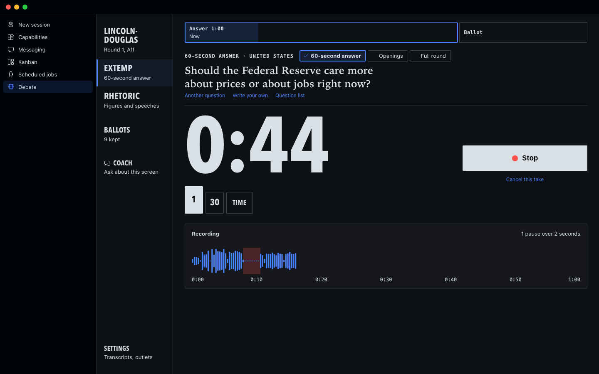

# Debate Workbench for Hermes

Practice speech and debate out loud, inside the Hermes desktop app: Lincoln-Douglas, extemp and rhetoric.

You speak; a real clock runs and the timekeeper holds up the cards. Your recording stays on your computer, and a transcript, words a minute, pauses and fillers are worked out there too. A judge's ballot follows every speech. Every ballot is kept, so the things judges keep writing show up as patterns you can drill.

It uses the AI model you already set up in Hermes. It never writes your speeches for you.

## What you can do

**Speak, on the clock.** Every event shares one floor. A strip across the top shows the event drawn to scale in time: each part is as wide as its minutes. The big clock starts when you start talking. The time cards flip at each minute, at 30 seconds, and at Time. While you speak, your voice is drawn as it comes in, with a mark over every pause longer than 2 seconds. No microphone? Type your speech and the time is estimated at 140 words a minute, and it says so.

**Extemp.** It opens on a 60-second answer, ready to speak: one question, one minute, a ballot in under a minute. Openings gives you 45 seconds, three times, to open the same question three different ways; the coach says which one is strongest and why, and never writes one for you. The full round works like a tournament. Pull this week's headlines on your topic from outlets on the left, the center and the right, side by side and labeled by lean. Save the ones you want to your extemp file. Draw three questions from your own saved news, pick one, and prep for 30 minutes with an outline: attention-getter, link, answer, three areas, conclusion, and sources from your file. Prep files only, or with the internet allowed, through your own Hermes web search. Then give a 7-minute speech and get an extemp ballot: did you answer the question, your analysis, your organization, how many sources you named and when they were from, delivery and time.

**Lincoln-Douglas.** Write your own case in the Case Workbench, with a coach that finds the weak spot and asks the question that makes it stronger. Then debate a full practice round in NSDA order against an AI opponent (Novice, JV or Varsity): 6, 3, 7, 3, 4, 6 and 3 minutes, with 4 minutes of prep. Speak your speeches or type them. The opponent questions you and you question the opponent, and a flow sheet fills in as you go. A judge you pick (parent judge, traditional coach or flow judge) writes the ballot.

**The ballot, read in ten seconds.** The decision, your points on the 20 to 30 scale, the three lines that decided it, and one drill stamped on the sheet. Every quoted line is checked against what was really said; a line that is not there is flagged. The full reason for decision is folded underneath. Ask another judge to rule on the same round, or redo one speech and have the same judge rule again.

**Rhetoric.** Six great public-domain speeches with their figures of speech marked, each mark checked against the text. The figures are grouped by the effect they make, with the same definitions as The Clearing. Paste any speech to have its figures found. Then spot the figure in a real line, write your own line using it (the coach critiques it but never writes it), and say it out loud. Further reading: Mark Forsyth, *The Elements of Eloquence*.

**Ballots.** Every ballot from every event. The patterns judges keep writing are counted in code from a fixed list ("You drop arguments in the 2AR: 4 of your last 6"), not guessed by the model. Pace, time, pauses and a late answer are measured from your recordings. Each ballot's drill can be checked off.

**More for Lincoln-Douglas.** A topic briefing for each new resolution. Fallacies: 15 common mistakes in reasoning, a practice drill, and a checker for any argument, plus "Spot fallacies" under every speech the opponent gives. Keep as many cases as you want; bring one in from a Word document or text file without a word changed; save, print or back up.

**Settings.** Pick the transcript model and see whether it is already on your computer, see and delete your recordings, edit your news outlets and their lean labels, and read exactly what leaves your computer.

## How to install it

You need the Hermes desktop app, version 0.22 or newer, with a model already set up. Debate Workbench uses that model.

1. In Hermes Desktop, click **Capabilities**, then **Plugins**, then **Install from Git**.
2. Paste `https://github.com/Dgardenhire/hermes-ld-workbench` and confirm. Keep both parts selected: the agent plugin and the desktop plugin.
3. In **Capabilities**, then **Plugins**, find **Debate Workbench** and switch it on.
4. Click **Debate** in the left sidebar.

Prefer the terminal? Run `hermes plugins install Dgardenhire/hermes-ld-workbench --enable`, then do steps 3 and 4.

To check that everything is in place, run `hermes plugins doctor ld-workbench`. It should say OK.

The manual is in [docs/MANUAL.md](docs/MANUAL.md), including what to do when something goes wrong. What changed in 0.2: [CHANGELOG.md](CHANGELOG.md).

## Where your work is saved

Your cases, coach notes, rounds, ballots, topic briefings, recordings, transcripts and extemp file are saved by Hermes on your own computer, in a folder named `plugin-data/ld-workbench` inside your Hermes folder. There are no accounts and no tracking.

## What leaves your computer

- **Your AI model.** When you use the coach, a helper, the briefing, a round, a ballot, the question draw or the figure finder, the text it needs (your case, your speeches, the resolution, your saved headlines) goes to the AI model you chose in Hermes, through Hermes. Debate Workbench has no keys of its own.
- **Your voice stays on your computer.** The microphone is open only between Start speaking and Stop (or Cancel, an error, or leaving the page). Recordings are saved only in `plugin-data/ld-workbench/recordings/` inside your Hermes folder: the newest 20, never more than 100 MB, with a button to delete them all. Transcripts are made on the Hermes backend with faster-whisper, when Hermes's local speech-to-text is installed. The first transcript downloads faster-whisper's speech model from huggingface.co (no audio is sent). If your Hermes app talks to Hermes on another computer, the recording goes to that computer to be transcribed.
- **Headlines, only when you press Pull headlines.** For your topic, a Google News search for each outlet on your list (`news.google.com`), and that outlet's own news feed if Google does not answer. Headlines, dates and links only; no article is downloaded. Https only, public addresses only, 8 seconds and 250 KB per outlet. Links open in your own browser.
- **A web search, only in an extemp round you start with the internet allowed.** The words you search for go to the web search you set up in Hermes. Titles, links and short snippets come back. Debate Workbench has no search key or scraper of its own.
- **Hear it, only when you press it.** The opponent's speech (written by the AI, not by you) goes to the voice you set up in Hermes to be read aloud. The audio is kept in `plugin-data/ld-workbench/voice/`, newest 8 only.
- **A link you save or add as a topic source.** Debate Workbench opens that one public web page to read its text. It only opens public addresses, and it keeps the first 30,000 characters.

Nothing else is sent anywhere. Lean labels are from the AllSides Media Bias Ratings, checked Nov 7, 2026, and you can change any of them. Debate Workbench is not made or endorsed by Nous Research, the National Speech & Debate Association, AllSides or any news outlet.

## Disclosures

- **Microphone.** Hermes may ask once for microphone permission. The microphone is open only while you are speaking a take, never in the background.
- **Recordings of students.** Recordings and transcripts stay on the computer that runs Hermes. If a minor uses it, a parent or coach can delete every recording in Settings at any time.
- **The opponent, the judge and the coach are an AI model,** the one you chose in Hermes. Their ballots are practice ballots, not the ruling of a real judge. Patterns across ballots are counted in code from a fixed list; quoted lines are checked against what was said and flagged when they are not there.
- **Transcripts are optional.** Debate Workbench does not install faster-whisper. It uses it only when Hermes's own local speech-to-text is already set up. Without it, takes keep real timing and pauses.
- **News.** Headlines and links only, from Google News RSS and the outlets' own feeds. Lean labels are from the AllSides Media Bias Ratings, checked Nov 7, 2026, and every label can be changed. Inclusion of an outlet is not an endorsement.
- **Speeches and definitions.** The six speeches in Rhetoric are public domain (texts from Wikisource). The figure definitions are shared with The Clearing, another plugin by the same author. Further reading: Mark Forsyth, *The Elements of Eloquence* (Icon Books, 2013).
- **Not affiliated.** Debate Workbench is an independent community plugin. It is not made or endorsed by Nous Research, the National Speech & Debate Association, AllSides or any news outlet.
- **Nothing runs on its own.** No background jobs, no telemetry, no shell commands, no self-updates. Every network call starts with a button you press.

## The coaching rule

The coach helps and pushes. It explains ideas, lays out choices, and points to where evidence lives. It does not write your case, and it never makes up quotes, numbers or sources. If you ask it to write your case, it says the words have to be yours and gives you the next step instead.

## For developers

- The method (every prompt, the round format, the judges) is in `ld_method.py`, copied from the web app at linchpin.studio/debate. Keep the two in sync.
- The backend is `dashboard/plugin_api.py`. All model calls go through Hermes's plugin model access (`PluginLlm`), so they use the user's own model and keys.
- The page is built from `desktop/src/plugin.js` with the shared Hermes UI kit: `node <path-to>/hermes-ui-kit/scripts/build.mjs .`
- Tests: `/usr/bin/python3 -m unittest discover -s tests`
- Screenshots: serve the folder (`/usr/bin/python3 -m http.server 8793 --directory .`) and run `harness/shoot.sh`. `harness/live.mjs` records from Chrome's fake microphone to check the recorder. `harness/make_fixtures.py` rebuilds the 0.2 fixtures from the plugin's own code.
- Status, risks and what is left: `docs/STATUS.md`.

License: MIT. By Damon Gardenhire.
